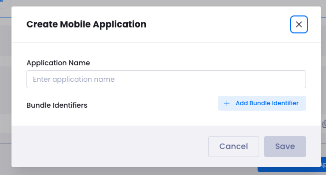
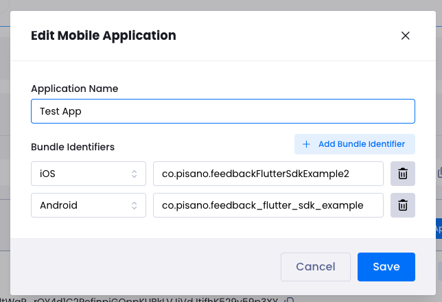
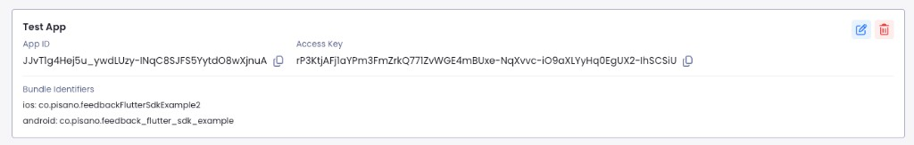
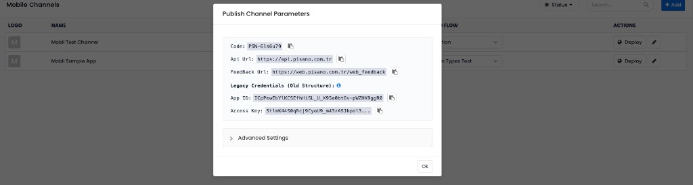

# Pisano Feedback SDK — Developer Guide (All Platforms)

Pisano Feedback SDK allows you to collect in-app surveys and user feedback across **iOS**, **Android**, **React Native**, and **Flutter**. This guide covers everything you need: getting your credentials from the Pisano panel, installing the SDK for each platform, initializing it, displaying surveys, and handling callbacks.

Each platform has a dedicated **sample app** you can clone and run immediately.

| Platform | SDK | Sample app |
|----------|-----|------------|
| **iOS** | [`PisanoFeedback`](https://github.com/Pisano/pisano-ios) | [feedback-sample-ios-app](https://github.com/Pisano/feedback-sample-ios-app) |
| **Android** | [`co.pisano:feedback`](https://github.com/Pisano/feedback-android) | [feedback-sample-android-app](https://github.com/Pisano/feedback-sample-android-app) |
| **React Native** | [`feedback-react-native-sdk`](https://github.com/Pisano/feedback-react-native-sdk) | [feedback-sample-react-native-app](https://github.com/Pisano/feedback-sample-react-native-app) |
| **Flutter** | [`feedback_flutter_sdk`](https://github.com/Pisano/feedback-flutter-sdk) | [feedback-sample-flutter-app](https://github.com/Pisano/feedback-sample-flutter-app) |

---

## Table of contents

- [Where to get credentials (Pisano panel)](#where-to-get-credentials-pisano-panel)
- [Common concepts](#common-concepts)
- [iOS (Native — Swift / Objective-C)](#ios-native--swift--objective-c)
- [Android (Native — Kotlin / Java)](#android-native--kotlin--java)
- [React Native](#react-native)
- [Flutter](#flutter)
- [Callback / Status values](#callback--status-values)
- [Summary tables](#summary-tables)

---

## Where to get credentials (Pisano panel)

All SDKs require these values to initialize:

| Parameter | Where to find | Example |
|-----------|---------------|---------|
| `appId` | Profile → Mobile applications → app card | `N8av-JTpP...` |
| `accessKey` | Profile → Mobile applications → app card | `eEantRilu-s8...` |
| `code` | Mobile Channels → Deploy → Publish Channel Parameters | `PSN-61s6u79` |
| `apiUrl` | Mobile Channels → Deploy → Publish Channel Parameters | `https://api.pisano.com.tr` |
| `feedbackUrl` | Mobile Channels → Deploy → Publish Channel Parameters | `https://web.pisano.com.tr/web_feedback` |
| `eventUrl` (optional) | Mobile Channels → Deploy → Publish Channel Parameters | `https://track.pisano.com.tr/track` |

### Step 1 — Create a Mobile Application (App ID + Access Key)

1. In the Pisano panel, go to **Profile** → **Mobile applications**.
2. Click **Create Mobile Application**.
3. Enter an **Application name** (e.g. "My App").
4. Click **+ Add Bundle Identifier** and add identifiers for each platform:
   - iOS: your app's bundle ID (e.g. `com.yourcompany.yourapp`)
   - Android: your app's package name (e.g. `com.yourcompany.yourapp`)
5. Click **Save**.

The app card now shows **App ID** and **Access Key** with copy buttons.







### Step 2 — Create / Deploy a Mobile Channel (Code + URLs)

1. Go to **Mobile Channels**.
2. Create a new channel (**+ Add**) or select an existing one. Configure the survey flow as needed.
3. Click the **Deploy** button (globe icon).
4. The **Publish Channel Parameters** modal shows three values at the top:
   - **Code** — survey/channel code (e.g. `PSN-61s6u79`)
   - **Api Url** — API base URL
   - **Feedback Url** — feedback widget URL

Use these together with the App ID and Access Key from Step 1. The "Legacy Credentials" section in the same modal is for older SDK versions; ignore it.



---

## Common concepts

### Init / Boot once

Call the SDK's initialization method **once** at app startup (before any `show` or `track` call). All SDKs require: `appId`, `accessKey`, `code`, `apiUrl`, `feedbackUrl`. The `eventUrl` parameter is optional (required only if you use event tracking).

**Do not commit** these values to your repository. Use local config files and add them to `.gitignore`.

### The `code` parameter

`code` is **required** at init. It identifies which survey/channel you want to display.

In `show()` and `healthCheck()`, `code` is **optional**:
- If you **omit** it, the SDK uses the default `code` from init.
- If you **pass** a different `code`, it overrides the default **for that call only**.

This allows apps with **multiple surveys** to show different surveys by passing different codes per call.

### Display rate limiting (`display_rate`)

The backend can return a `display_rate` value (0–100) for a survey. The SDK decides whether to show or skip based on this value. When skipped, the callback receives a `displayRateLimited` / `DISPLAY_RATE_LIMITED` status.

### Display once (`display_once`)

If a survey is configured to show only once per user, subsequent calls return `displayOnce` / `DISPLAY_ONCE` and the widget will not open.

---

## iOS (Native — Swift / Objective-C)

**SDK repository:** [github.com/Pisano/pisano-ios](https://github.com/Pisano/pisano-ios) — recommended **`PisanoFeedback` 2.0.0**
**Sample app:** [github.com/Pisano/feedback-sample-ios-app](https://github.com/Pisano/feedback-sample-ios-app) — open **`pisano-ios-sdk-sample-app-uikit`** for the **recommended UIKit** reference; a SwiftUI sample is included too.

### Requirements

- iOS 15.0+ (apps that still support iOS 12–14 can stay on 1.1.0)
- Xcode 16.0+
- Swift 5.9+, Swift 6 language mode supported (Objective-C also supported)

### Installation

#### Swift Package Manager (recommended)

1. In Xcode: **File → Add Package Dependencies...**
2. Enter package URL:

```
https://github.com/Pisano/pisano-ios.git
```

3. Set version rule: **Up to Next Major** → **2.0.0**
4. Select the **`PisanoFeedback`** product and add it to your app target.

#### CocoaPods

Add to your `Podfile`:

```ruby
platform :ios, '15.0'
use_frameworks!

target 'YourApp' do
  pod 'Pisano', '~> 2.0'
end
```

Then run:

```bash
pod install
```

Open the `.xcworkspace` file (not `.xcodeproj`) after installation.

### Usage

```swift
import PisanoFeedback

// ━━━━━━━━━━━━━━━━━━━━━━━━━━━━━━━━━━━━━━━━━━━━━━
// 1. BOOT — call once at app startup (AppDelegate)
// ━━━━━━━━━━━━━━━━━━━━━━━━━━━━━━━━━━━━━━━━━━━━━━

#if DEBUG
Pisano.debugMode(true)   // verbose logs in debug builds
#endif

Pisano.boot(appId: "YOUR_APP_ID",
           accessKey: "YOUR_ACCESS_KEY",
           code: "YOUR_CODE",               // required
           apiUrl: "https://api.pisano.co",
           feedbackUrl: "https://web.pisano.co/web_feedback",
           eventUrl: nil) { succeeded in     // optional
    print("Booted: \(succeeded)")
}


// ━━━━━━━━━━━━━━━━━━━━━━━━━━━━━━━━━━━━━━━━━━━━━━
// 2. SHOW — display the feedback widget
// ━━━━━━━━━━━━━━━━━━━━━━━━━━━━━━━━━━━━━━━━━━━━━━

// Minimal — uses boot code, full-screen mode
Pisano.show { status in
    print("Show status: \(status.description)")
}

// Full parameters
Pisano.show(
    mode: .bottomSheet,                                          // .default or .bottomSheet
    title: NSAttributedString(string: "We Value Your Feedback"), // optional
    language: "en",                                              // optional
    pisanoCustomer: PisanoCustomer(name: "John Doe",             // optional
                                   email: "john@example.com",
                                   phoneNumber: "+1234567890",
                                   externalId: "CRM-12345",
                                   customAttributes: ["plan": "gold"]),
    payload: ["source": "app", "screen": "home"],                // optional
    code: "ANOTHER_SURVEY_CODE",                                 // optional override
    dismissOnDrag: false                                         // optional — swipe dismiss when .bottomSheet
) { status in
    print("Show status: \(status.description)")
}


// The customer is a PisanoCustomer (2.0+): fixed fields, same as Android, so a
// misspelled field does not compile. The 1.x customer dictionary is gone.

// Events (2.0+): what happened while the survey was on screen
let subscription = Pisano.subscribe { event in
    print("Event: \(event.type.rawValue), close reason: \(event.closeReason.rawValue)")
}

// Leave the App Store review prompt to your app (2.0+)
Pisano.automaticStoreReview = false


// ━━━━━━━━━━━━━━━━━━━━━━━━━━━━━━━━━━━━━━━━━━━━━━
// 3. HEALTH CHECK — verify reachability before show
// ━━━━━━━━━━━━━━━━━━━━━━━━━━━━━━━━━━━━━━━━━━━━━━

Pisano.healthCheck(language: "en", pisanoCustomer: nil, payload: nil, code: nil) { ok in
    if ok {
        Pisano.show { status in print(status.description) }
    } else {
        print("Health check failed")
    }
}


// ━━━━━━━━━━━━━━━━━━━━━━━━━━━━━━━━━━━━━━━━━━━━━━
// 4. TRACK — track a custom event
// ━━━━━━━━━━━━━━━━━━━━━━━━━━━━━━━━━━━━━━━━━━━━━━

Pisano.track(event: "purchase_completed",
            payload: ["product_id": "PROD-123"],
            pisanoCustomer: PisanoCustomer(externalId: "USER-456"),
            language: "en") { sent in
    print("Track sent: \(sent)")
}


// ━━━━━━━━━━━━━━━━━━━━━━━━━━━━━━━━━━━━━━━━━━━━━━
// 5. CLEAR — end the session (logout, user / tenant switch)
// ━━━━━━━━━━━━━━━━━━━━━━━━━━━━━━━━━━━━━━━━━━━━━━

Pisano.clear()   // then boot again for the new user / tenant
```

### Objective-C

```objc
#import <PisanoFeedback/PisanoFeedback-Swift.h>

// Boot
[Pisano bootWithAppId:@"YOUR_APP_ID"
           accessKey:@"YOUR_ACCESS_KEY"
               code:@"YOUR_CODE"
              apiUrl:@"https://api.pisano.co"
         feedbackUrl:@"https://web.pisano.co/web_feedback"
            eventUrl:nil
          completion:^(BOOL succeeded) {
    NSLog(@"Booted: %d", succeeded);
}];

// Show
[Pisano showWithMode:ViewModeBottomSheet
              title:[[NSAttributedString alloc] initWithString:@"Feedback"]
           language:@"en"
     pisanoCustomer:[[PisanoCustomer alloc] initWithName:nil email:nil phoneNumber:nil
                                              externalId:@"USER-123" customAttributes:nil]
            payload:@{@"source": @"app"}
               code:nil
      dismissOnDrag:NO
         completion:^(enum CloseStatus status) {
    NSLog(@"Show: %@", [CloseStatusHelper description:status]);
}];

// Events (2.0+)
PisanoSubscription *subscription = [Pisano subscribe:^(PisanoEvent *event) {
    NSLog(@"Event: %ld", (long)event.type);
}];
```

### Threading, timeout and cancellation

- Call the SDK from the main thread. No call blocks it; every `completion` and event handler arrives asynchronously on the main thread (they are `@MainActor` closures, and the SDK is Swift 6 ready).
- `Pisano.requestTimeout = 15` sets the network timeout in seconds (default 30, as on Android).
- `boot`, `healthCheck`, `show` and `track` return a `PisanoTask`; `task.cancel()` ends the call and calls its completion once (`false` for `boot` / `healthCheck` / `track`, `.none` for `show`).
- `Pisano.clear()` cancels running calls, closes an open survey and removes all SDK data of the session. The full list is in the [pisano-ios README](https://github.com/Pisano/pisano-ios#logout-and-user--tenant-switch).

---

## Android (Native — Kotlin / Java)

**SDK repository:** [github.com/Pisano/feedback-android](https://github.com/Pisano/feedback-android)
**Sample app:** [github.com/Pisano/feedback-sample-android-app](https://github.com/Pisano/feedback-sample-android-app)

### Requirements

- minSdk 21+, compileSdk 34+
- Kotlin or Java 8+
- AndroidX

### Installation

#### Gradle (Maven Central)

In your **project-level** `build.gradle`, ensure Maven Central is included:

```gradle
allprojects {
    repositories {
        google()
        mavenCentral()
    }
}
```

In your **app-level** `build.gradle`:

```gradle
dependencies {
    implementation 'co.pisano:feedback:2.0.0'
}
```

> The coordinate is `co.pisano:feedback`. The old `co.pisano.feedback:feedback` coordinate is no longer updated.

The SDK's manifest adds `INTERNET` and `ACCESS_NETWORK_STATE`; it does not set `android:allowBackup`.

### Usage

```kotlin
import co.pisano.feedback.data.helper.CloseStatus
import co.pisano.feedback.data.helper.PisanoEventType
import co.pisano.feedback.data.helper.ViewMode
import co.pisano.feedback.data.model.PisanoCustomer
import co.pisano.feedback.data.model.Title
import co.pisano.feedback.managers.PisanoSDK
import co.pisano.feedback.managers.PisanoSDKManager

// ━━━━━━━━━━━━━━━━━━━━━━━━━━━━━━━━━━━━━━━━━━━━━━
// 1. INIT — call once at app startup (Application class)
// ━━━━━━━━━━━━━━━━━━━━━━━━━━━━━━━━━━━━━━━━━━━━━━

val manager = PisanoSDKManager.Builder(context)
    .setApplicationId("YOUR_APP_ID")
    .setAccessKey("YOUR_ACCESS_KEY")
    .setCode("YOUR_CODE")                            // required
    .setApiUrl("https://api.pisano.co")
    .setFeedbackUrl("https://web.pisano.co/web_feedback")
    .setEventUrl("https://track.pisano.co/track")    // optional, needed for track
    .setDebug(BuildConfig.DEBUG)                      // verbose logs in debug
    .build()

PisanoSDK.init(manager) { succeeded ->
    Log.d("Pisano", "init: $succeeded")            // false: wrong credentials/URL or no connection
}


// ━━━━━━━━━━━━━━━━━━━━━━━━━━━━━━━━━━━━━━━━━━━━━━
// 2. EVENTS (optional) — what happens while a survey is on screen
// ━━━━━━━━━━━━━━━━━━━━━━━━━━━━━━━━━━━━━━━━━━━━━━

val subscription = PisanoSDK.subscribe { event ->
    when (event.type) {
        PisanoEventType.OPENED -> Log.d("Pisano", "opened ${event.code}")
        PisanoEventType.FEEDBACK_SUBMITTED -> Log.d("Pisano", "submitted, chat=${event.hasChat}")
        PisanoEventType.REDIRECTED_TO_STORE -> Log.d("Pisano", "store, handledBySDK=${event.handledBySDK}")
        PisanoEventType.CLOSED -> Log.d("Pisano", "closed: ${event.closeReason}")
    }
}
// later: subscription.cancel()


// ━━━━━━━━━━━━━━━━━━━━━━━━━━━━━━━━━━━━━━━━━━━━━━
// 3. SHOW — display the feedback widget (one result per call)
// ━━━━━━━━━━━━━━━━━━━━━━━━━━━━━━━━━━━━━━━━━━━━━━

PisanoSDK.show(
    viewMode = ViewMode.BOTTOM_SHEET,
    title = Title(text = "We Value Your Feedback", textSize = 18f),
    language = "en",
    payload = hashMapOf("source" to "app", "screen" to "home"),
    pisanoCustomer = PisanoCustomer(
        name = "John Doe",
        email = "john@example.com",
        phoneNumber = "+1234567890",
        externalId = "CRM-12345",
    ),
    code = null,              // null = init code; or a string to override for this call
    dismissOnDrag = false,    // true: a drag down closes the bottom sheet
) { status ->
    if (status == CloseStatus.SEND_FEEDBACK) Log.d("Pisano", "feedback sent")
}


// ━━━━━━━━━━━━━━━━━━━━━━━━━━━━━━━━━━━━━━━━━━━━━━
// 4. HEALTH CHECK — would a survey open right now? (nothing is shown)
// ━━━━━━━━━━━━━━━━━━━━━━━━━━━━━━━━━━━━━━━━━━━━━━

PisanoSDK.healthCheck(pisanoCustomer = PisanoCustomer(externalId = "USER-123")) { canShow ->
    if (canShow) showFeedbackButton()
}


// ━━━━━━━━━━━━━━━━━━━━━━━━━━━━━━━━━━━━━━━━━━━━━━
// 5. TRACK — send a custom event; a survey it triggers opens on its own
// ━━━━━━━━━━━━━━━━━━━━━━━━━━━━━━━━━━━━━━━━━━━━━━

PisanoSDK.track(
    event = "purchase_completed",
    payload = hashMapOf("product_id" to "PROD-123"),
    pisanoCustomer = PisanoCustomer(externalId = "USER-456"),
    language = "en",
) { sent -> Log.d("Pisano", "track sent: $sent") }


// ━━━━━━━━━━━━━━━━━━━━━━━━━━━━━━━━━━━━━━━━━━━━━━
// 6. SETTINGS (optional)
// ━━━━━━━━━━━━━━━━━━━━━━━━━━━━━━━━━━━━━━━━━━━━━━

PisanoSDK.requestTimeout = 15            // seconds, default 30
PisanoSDK.automaticStoreReview = false   // the app asks for the review prompt on REDIRECTED_TO_STORE


// ━━━━━━━━━━━━━━━━━━━━━━━━━━━━━━━━━━━━━━━━━━━━━━
// 7. CLEAR — end the session (logout, user / tenant switch)
// ━━━━━━━━━━━━━━━━━━━━━━━━━━━━━━━━━━━━━━━━━━━━━━

PisanoSDK.clear()   // closes an open survey; call init again for the next user
```

`init`, `healthCheck`, `show` and `track` return a `PisanoTask`; `task.cancel()` stops a call that has not finished (`false`, or `NONE` for `show`).

---

## React Native

**SDK repository:** [github.com/Pisano/feedback-react-native-sdk](https://github.com/Pisano/feedback-react-native-sdk)
**npm:** [`feedback-react-native-sdk`](https://www.npmjs.com/package/feedback-react-native-sdk) — **1.0.0** (native Pisano 2.0)
**Sample app:** [github.com/Pisano/feedback-sample-react-native-app](https://github.com/Pisano/feedback-sample-react-native-app)

### Requirements

| Dependency | Minimum version |
|------------|-----------------|
| React Native | 0.82+ (New Architecture only) |
| React | 19.1+ |
| iOS | 15.1+, Xcode 16+, CocoaPods |
| Android | minSdk 21, compileSdk 34+, JDK 17 |

### Installation

```bash
npm install feedback-react-native-sdk
# or
yarn add feedback-react-native-sdk
```

iOS: run `pod install` in your `ios/` directory. Android: no extra step.

### Configuration

Keep credentials out of source control. The sample app reads them from `src/pisano.config.ts` (git-ignored, created from `pisano.config.example.ts`).

### Usage

```ts
import {
  feedbackSDKBoot,
  feedbackSDKCallback,
  feedbackSDKClear,
  feedbackSDKDebugMode,
  feedbackSDKHealthCheck,
  feedbackSDKOn,
  feedbackSDKSetAutomaticStoreReview,
  feedbackSDKSetRequestTimeout,
  feedbackSDKShow,
  feedbackSDKTrack,
  feedbackSDKViewMode,
} from 'feedback-react-native-sdk';

// 0. Debug logs (optional, before boot)
feedbackSDKDebugMode(true);

// 1. Boot — once at app startup; resolves a boolean
const booted = await feedbackSDKBoot({
  appId: 'YOUR_APP_ID',
  accessKey: 'YOUR_ACCESS_KEY',
  code: 'YOUR_CODE',                                // required
  apiUrl: 'https://api.pisano.co',
  feedbackUrl: 'https://web.pisano.co/web_feedback',
  eventUrl: 'https://track.pisano.co/track',        // optional, needed for track
});

// 2. Events (optional) — returns an unsubscribe function
const unsubscribe = feedbackSDKOn((event) => {
  // event.type: 'opened' | 'feedbackSubmitted' | 'redirectedToStore' | 'closed'
  console.log(event.type, event.closeReason ?? '');
});

// 3. Show — resolves once with a feedbackSDKCallback value
const result = await feedbackSDKShow({
  viewMode: feedbackSDKViewMode.BottomSheet,
  title: 'We Value Your Feedback',
  language: 'en',
  dismissOnDrag: true,
  customer: { email: 'user@example.com', externalId: 'USER-123' },
  payload: { source: 'app' },
});
if (result === feedbackSDKCallback.SendFeedback) {
  // the survey was submitted
}

// 4. Health check — would a survey open right now?
const canShow = await feedbackSDKHealthCheck({ customer: { externalId: 'USER-123' } });

// 5. Track — resolves true when the server accepted the event
const sent = await feedbackSDKTrack({ event: 'purchase_completed', payload: { productId: 'PROD-123' } });

// 6. Settings (optional)
feedbackSDKSetRequestTimeout(15);            // seconds, default 30
feedbackSDKSetAutomaticStoreReview(false);   // the app asks for the review prompt on redirectedToStore

// 7. Clear — logout / user switch; boot again for the next user
feedbackSDKClear();
```

Customer keys follow `PisanoCustomer`: `name`, `email`, `phoneNumber`, `externalId`, `customAttributes`. Other spellings (`phone_number`, `external_id`, `custom_attrs`, any case) are mapped; an unknown key is not sent and logs a warning.

### Enums

**`feedbackSDKViewMode`**: `Default` (full screen), `BottomSheet`.

**`feedbackSDKCallback`** — the `show` result: `SendFeedback`, `Closed`, `None`, `DisplayOnce`, `PreventMultipleFeedback`, `ChannelQuotaExceeded`, `ChannelPassive`, `DisplayRateLimited`. See [Callback / Status values](#callback--status-values).

### Troubleshooting

| Problem | Solution |
|---------|----------|
| **Android:** "Unable to load script" | Run `adb reverse tcp:8081 tcp:8081` and make sure Metro is running |
| **iOS:** build fails after an SDK update | `cd ios && pod install`, then clean the build folder in Xcode |
| `feedbackSDKShow` resolves `None` | Check that `feedbackSDKBoot` resolved `true`; turn on debug mode |

---

## Flutter

**SDK repository:** [github.com/Pisano/feedback-flutter-sdk](https://github.com/Pisano/feedback-flutter-sdk)
**Sample app:** [github.com/Pisano/feedback-sample-flutter-app](https://github.com/Pisano/feedback-sample-flutter-app)

### Requirements

- Flutter 3.0+, Dart 2.17+
- iOS 15.0+, Xcode 16+ (Swift Package Manager or CocoaPods)
- Android minSdk 21, compileSdk 34+, JDK 17

### Installation

```yaml
dependencies:
  feedback_flutter_sdk:
    git:
      url: https://github.com/Pisano/feedback-flutter-sdk.git
      ref: 1.0.0
```

Then `flutter pub get`. Credentials should be passed with `--dart-define-from-file=pisano_defines.json` (git-ignored); see the sample app.

### Usage

```dart
import 'package:feedback_flutter_sdk/feedback_flutter_sdk.dart';

final feedbackSdk = FeedbackFlutterSdk();

// 1. Init — once at app startup; completes with a bool
final booted = await feedbackSdk.init(
  'YOUR_APP_ID',
  'YOUR_ACCESS_KEY',
  'https://api.pisano.co',
  'https://web.pisano.co/web_feedback',
  'https://track.pisano.co/track',   // eventUrl, optional (needed for track)
  debugLogging: false,
  code: 'YOUR_CODE',                 // required
);

// 2. Events (optional)
final subscription = feedbackSdk.events.listen((event) {
  // event.type: opened, feedbackSubmitted, redirectedToStore, closed
  print('${event.type} ${event.closeReason ?? ''}');
});

// 3. Show — completes once with a FeedbackCallback
final result = await feedbackSdk.show(
  viewMode: ViewMode.bottomSheetMode,
  title: 'We Value Your Feedback',
  language: 'en',
  dismissOnDrag: true,
  customer: const PisanoCustomer(email: 'john@example.com', externalId: 'CRM-12345'),
  payload: {'source': 'app'},
);

// 4. Health check — would a survey open right now?
final canShow = await feedbackSdk.healthCheck();

// 5. Track — true when the server accepted the event
final sent = await feedbackSdk.track('purchase_completed', payload: {'product_id': 'PROD-123'});

// 6. Settings (optional)
await feedbackSdk.setRequestTimeout(const Duration(seconds: 15)); // default 30 s
await feedbackSdk.setAutomaticStoreReview(false);

// 7. Clear — logout / user switch; init again for the next user
await feedbackSdk.clear();
```

### ViewMode

| Value | Description |
|-------|-------------|
| `ViewMode.defaultMode` | Full-screen overlay |
| `ViewMode.bottomSheetMode` | Bottom sheet |

---

## Callback / Status values

`show()` reports one result per call. The names are the same on every platform (iOS 2.0, Android 2.0, React Native 1.0, Flutter 1.0):

| Result | iOS (`CloseStatus`) | Android (`CloseStatus`) | React Native (`feedbackSDKCallback`) | Flutter (`FeedbackCallback`) | Description |
|--------|---------------------|-------------------------|--------------------------------------|------------------------------|-------------|
| Feedback sent | `.sendFeedback` | `SEND_FEEDBACK` | `SendFeedback` | `sendFeedback` | Survey submitted, however the widget closed afterwards |
| Closed | `.closed` | `CLOSED` | `Closed` | `closed` | Closed without submitting (close button, back, drag, outside tap, app dismissed it); the `closed` event's `closeReason` says how |
| No result | `.none` | `NONE` | `None` | `none` | Not shown or no result: not booted, no connection, a failed request, page did not load, `clear()`, cancelled, or another survey was already open |
| Display once | `.displayOnce` | `DISPLAY_ONCE` | `DisplayOnce` | `displayOnce` | Already shown once, won't repeat |
| Prevent multiple feedback | `.preventMultipleFeedback` | `PREVENT_MULTIPLE_FEEDBACK` | `PreventMultipleFeedback` | `preventMultipleFeedback` | Customer already gave feedback in the period |
| Channel quota exceeded | `.channelQuotaExceeded` | `CHANNEL_QUOTA_EXCEEDED` | `ChannelQuotaExceeded` | `channelQuotaExceeded` | Channel quota is full |
| Channel passive | `.channelPassive` | `CHANNEL_PASSIVE` | `ChannelPassive` | `channelPassive` | Channel is passive |
| Display rate limited | `.displayRateLimited` | `DISPLAY_RATE_LIMITED` | `DisplayRateLimited` | `displayRateLimited` | Skipped due to `display_rate` throttling |

`boot` / `init`, `healthCheck` and `track` report a boolean. What happens while a survey is on screen (opened, submitted, store redirect, how it closed) comes through the event channel: `Pisano.subscribe` (iOS), `PisanoSDK.subscribe` (Android), `feedbackSDKOn` (React Native), `events` (Flutter).

---

## Summary tables

### Where credentials come from

| Source | Values | Used in |
|--------|--------|---------|
| Profile → Mobile applications | **App ID**, **Access Key** | Init/boot only |
| Mobile Channels → Deploy → Publish Channel Parameters | **Code**, **Api Url**, **Feedback Url** | Init/boot + optional per-call override |

### `code` parameter across all SDKs

| Method | `code` | When omitted |
|--------|--------|--------------|
| **Init / Boot** | **Required** | SDK cannot initialize |
| **Show** | Optional | Uses init/boot code |
| **Health check** | Optional | Uses init/boot code |
| **Track** | N/A | Uses current SDK context |

### SDK versions (2.0 release)

| Platform | SDK | Version | Package manager |
|----------|-----|---------|-----------------|
| iOS | `PisanoFeedback` | 2.0.0 | SPM / CocoaPods |
| Android | `co.pisano:feedback` | 2.0.0 | Gradle (Maven Central) |
| React Native | `feedback-react-native-sdk` | 1.0.0 | npm / yarn |
| Flutter | `feedback_flutter_sdk` | 1.0.0 | Git dependency (pubspec) |

### Security reminders

- **Never commit** `appId`, `accessKey`, or other credentials to source control.
- Use local config files:
  - iOS: `PisanoSecrets.plist` (gitignored)
  - Android: `local.properties` (gitignored)
  - React Native: `src/pisano.config.ts` (gitignored)
  - Flutter: `pisano_defines.json` (gitignored)
- Each sample app repo includes an example config file you can copy and fill.
